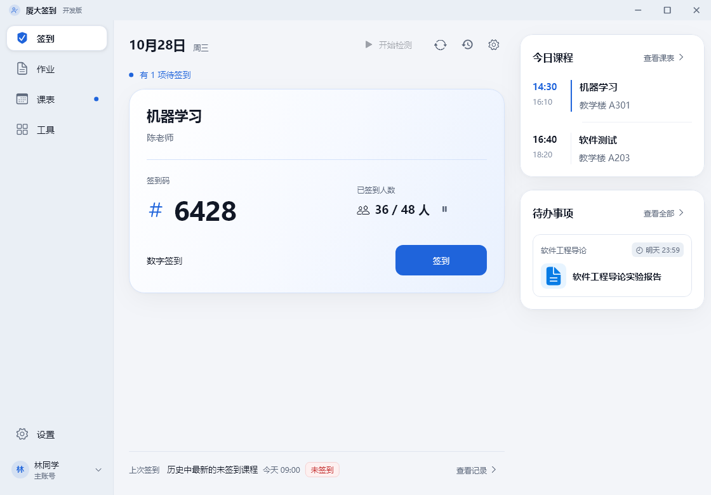
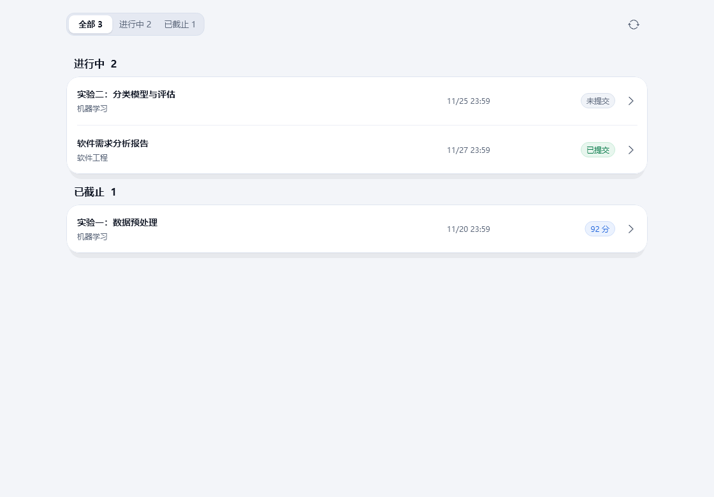
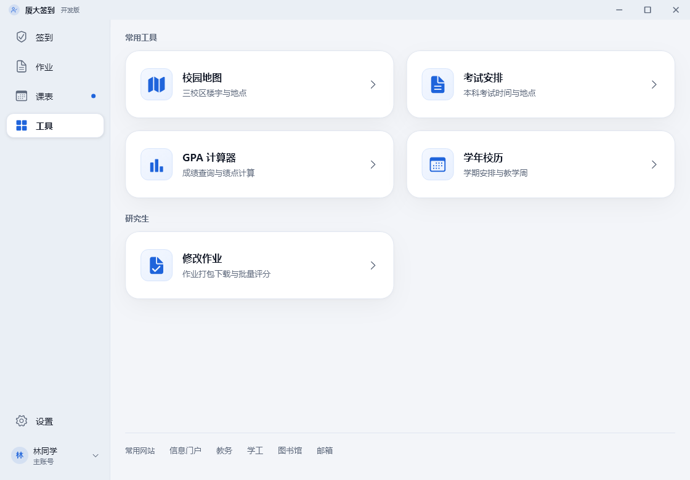
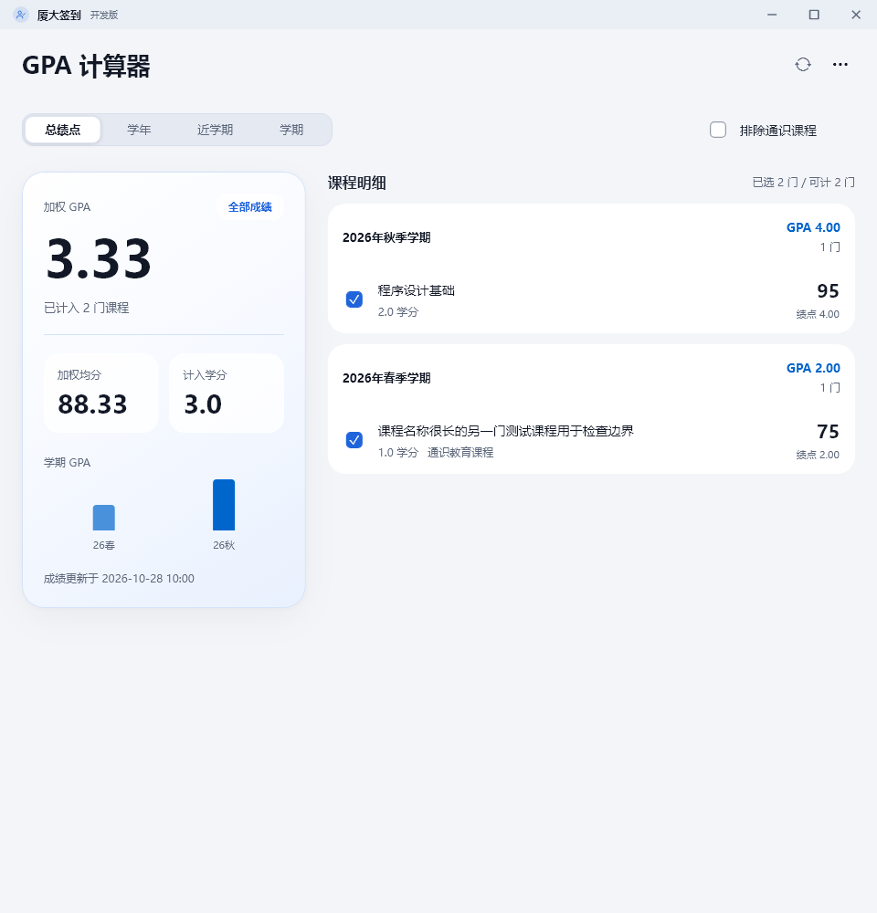
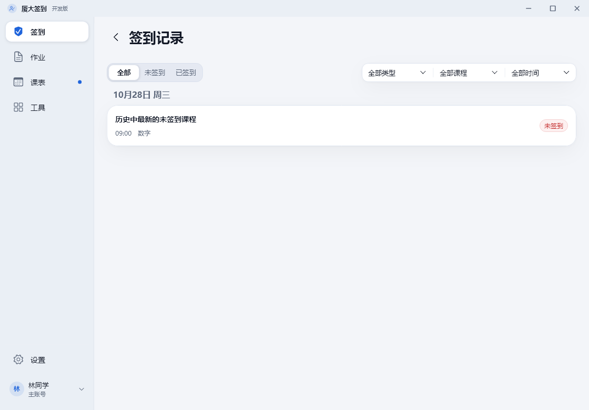
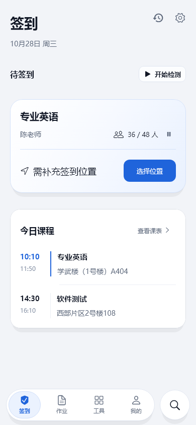
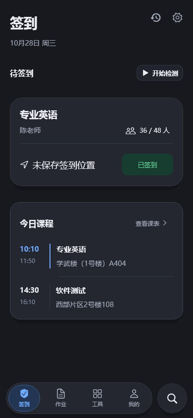
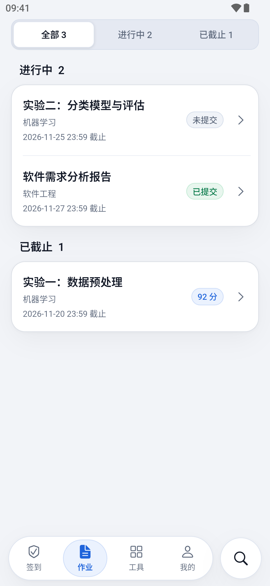
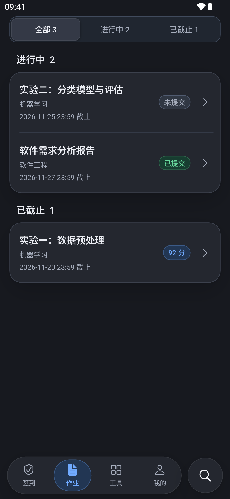

<div align="center">


# 厦大签到

**厦门大学畅课客户端，签到、作业与校园工具。**

Android / Windows　第三方开源项目，非学校官方应用。

[](https://github.com/MidiAug/xmu-rollcall/releases/latest)
[](https://github.com/MidiAug/xmu-rollcall/actions/workflows/checks.yml)
[](https://flutter.dev/)
[](LICENSE)

**[下载最新版](https://github.com/MidiAug/xmu-rollcall/releases/latest)**　[更新记录](CHANGELOG.md)　[安装指南](https://midiaug.github.io/xmu-rollcall/install.html)　[反馈问题](https://github.com/MidiAug/xmu-rollcall/issues)

[界面预览](#界面预览) / [功能概览](#功能概览) / [下载安装](#下载安装) / [开发与构建](#开发与构建)

</div>

## 界面预览

以下图片使用当前 Flutter 页面与演示数据。手机作业图在 Android 15 模拟器原生运行后截取，保留系统状态栏；其他图片为页面组件渲染，不含真实账号信息。点击图片查看大图。[预览生成方式](assets/screenshots/README.md)

### Windows

签到与今日课程、作业待办同屏，侧栏切换作业、课表与工具。窗口缩小时按可用空间调整布局。



<details open>
<summary><strong>作业与校园工具</strong></summary>

| 作业与提交状态 | 校园工具目录 |
| :---: | :---: |
|  |  |

</details>

<details>
<summary><strong>GPA 与签到记录</strong></summary>

| GPA 计算器 | 签到记录 |
| :---: | :---: |
|  |  |

</details>

### 手机布局

手机底部提供签到、作业、工具、我的四个入口及独立搜索。待签到时显示可执行操作，完成后保留结果；作业区分未提交、已提交和已出成绩。

<table>
  <tr><th>雷达签到与今日课程</th><th>已签到 / 深色</th><th>作业与成绩</th></tr>
  <tr>
    <td align="center"></td>
    <td align="center"></td>
    <td align="center"></td>
  </tr>
</table>

<details>
<summary>查看深色作业页</summary>



</details>

## 功能概览

| 功能 | 当前支持 |
| --- | --- |
| **数字、雷达、二维码签到** | 查看当前签到、复制或手动输入数字码、确认雷达位置、扫码提交；Windows 支持桌面二维码识别。 |
| **检测与提醒** | 按配置的课程和时段检测。Android 后台服务，Windows 托盘和系统通知；前台使用应用内提醒。 |
| **多账号独立运行** | 主账号与协助身份分别保存会话、缓存和检测配置，切换查看身份时保留其他账号正在运行的任务。 |
| **作业与签到记录** | 查看截止时间、提交情况和成绩，阅读作业说明与附件；签到记录按课程、状态、类型和时间筛选。 |
| **课表与上课地点** | 本周 / 学期课表、课程详情、叠课查看、课程地点与地图选点。 |
| **成绩与 GPA** | 查看可读取的成绩，按总绩点、学年、近学期或学期选择范围，勾选课程进行计算；区分本科与研究生规则。 |
| **考试与校历** | 本科考试安排、时间与地点 / 座位；学年校历、学期安排与教学周。 |
| **校园地图** | 三校区地图、建筑目录、搜索与建筑档案，复用已浏览公开地图瓦片的本机缓存。 |
| **助教作业** | 电脑端查看整班提交与成绩、逐项输入评分、查看评分记录、CSV 预览批量评分、全部或选人打包下载；手机端只读查看。 |
| **桌面网页与更新** | Windows 可在隔离的内置网页或系统浏览器打开校园网站；应用内检查更新、下载校验并由用户确认安装。 |

页面先显示当前身份已有缓存，再按业务需要更新；读取失败时保留旧数据。主要变化及版本边界见 [更新记录](CHANGELOG.md)。

### 使用边界

- **自动签到默认关闭。** 主动开启后，数字签到按设置的人数或比例等待；雷达还需当前账号、当前课程已配置的位置。没有位置时只提醒，结果不确定时需手动处理。
- Windows 退出或电脑睡眠后不继续检测；Android 需允许通知，并按手机情况设置后台运行。提醒设置提供测试和实际收到确认，不承诺所有设备后台常驻。
- 助教评分当前面向普通个人百分制作业。模拟协议与页面已有回归，真实课程评分、打包和设备行为仍需按实际权限核验。
- 课程、成绩和考试的可用范围由当前账号权限决定；地图缓存不等同于完整离线地图。

## 下载安装

**[前往最新正式发布页](https://github.com/MidiAug/xmu-rollcall/releases/latest)**，按设备选择文件：

| 平台 | 文件结尾 | 安装方式 |
| --- | --- | --- |
| Android | `-android.apk` | 下载到手机后按系统提示安装，首次可能需要允许此安装来源。 |
| Windows x64 安装版 | `-windows-x64-setup.exe` | 按向导安装，适合日常使用和应用内更新。 |
| Windows x64 便携版 | `-windows-x64.zip` | 完整解压后运行 `xmu_rollcall.exe`，保留同目录 DLL 与 `data` 文件夹。 |

`-android-preview.apk` 是 Actions 测试版，与正式版独立安装，不共享正式版登录数据；正式发布请下载不含 `preview` 的 APK。iOS、macOS 和 Linux 保留工程，但暂无正式安装包及完整实机验收。

### 更新已有版本

- **Windows：** 启动及回到前台时按间隔检查正式更新，发现后可后台下载并校验；下载就绪后在后续回到前台时提示，点击确认才启动安装并退出旧进程。也可到“我的 → 关于”查看进度、重试或手动操作。
- **Android：** 在“我的 → 关于”检查、下载并校验，由系统交互安装。覆盖安装需使用兼容的原签名，不兼容时请反馈，不要为更新先卸载。
- **便携版：** 可自行解压新 ZIP 替换程序文件；选择应用内安装器更新会转为安装版。

更新只认 GitHub 最新公开稳定 Release，草稿、标签和预发布版不会被当作正式更新。自动检查成功结果缓存 6 小时，失败退避 30 分钟；下载后核对文件大小与 SHA-256，正式包另附两端 manifest 和 `SHA256SUMS`。旧版本若不支持应用内更新，首次请从发布页手动升级。

Android 使用项目固定签名；Windows 目前没有 Authenticode 发布者签名。不要使用来源不明的改包或签名不兼容的 APK。

## 开发与构建

开发基线：**Flutter 3.47.9 / Dart 3.13.7**。Android 需要 Android SDK；Windows 需要 Visual Studio 的 C++ 桌面开发工具。

```powershell
git clone https://github.com/MidiAug/xmu-rollcall.git
cd xmu-rollcall

# 使用与锁文件一致的包源
$env:PUB_HOSTED_URL = 'https://pub.flutter-io.cn'
flutter pub get --enforce-lockfile
flutter run -d windows
# 或选择已连接的 Android 设备：flutter run
```

使用厦大统一身份认证账号登录，验证码、相机和通知权限按页面提示处理。令牌与凭据使用系统安全存储，业务缓存保存在本机。

<details>
<summary><strong>打包、检查与发布流程</strong></summary>

项目打包脚本将产物放到 `dist/`：

```powershell
pwsh -File scripts/package-android.ps1 -NoPub
pwsh -File scripts/package-windows.ps1 -NoPub

flutter analyze --no-pub
flutter test --no-pub
```

Windows 安装器另需 NSIS，脚本可在缺少时下载便携工具。Android 正式签名配置与 `-RequireSigning` 用法见 [CI/CD 文档](.github/CI_CD.md)。本机维护可直接使用 `fvm flutter`、已加入 `PATH` 的 `flutter` 或 `tool/flutter.ps1`（仓库根目录 `.fvmrc` 锁定 Flutter `3.47.9`）。

普通测试使用模拟数据；显式布局测试加载固定的测试字体，截图捕获模式使用 Windows 本机字体，见 [测试字体说明](test/fixtures/fonts/README.md)。截图生成与实看方法见 [预览维护说明](assets/screenshots/README.md)。

GitHub Actions 在 Windows / Linux 运行检查；推送 `main` 后构建预览包。正式版本递增版本号和 Android 构建号，更新 [CHANGELOG.md](CHANGELOG.md)，主分支 CI 通过后推送新版本标签。发布工作流使用固定 Android 签名、验证来源和哈希并生成草稿，再进行正式发布；不移动旧标签或替换已公开安装包。

项目网站、安装指南和 FAQ 的源码位于 [site/](site/)，网站部署与应用发布独立。协议结构与实现边界见 [接口资料](api-reference/README.md)。

</details>

## 反馈与接口资料

请在 [Issues](https://github.com/MidiAug/xmu-rollcall/issues) 描述系统版本、复现步骤和预期结果，必要时附截图。“我的 → 数据与诊断”可导出日志；分享前检查内容，不要提交密码、Cookie、登录令牌或他人的个人数据。

[接口流程参考](api-reference/README.md)保留脱敏的畅课、助教作业与信息门户协议结构、请求顺序和字段类型。历史抓包、客户端实现及真实服务器验收分别标注，原始抓包不进入仓库。

## 致谢与许可

- [wilinz/tronclass_plus](https://github.com/wilinz/tronclass_plus)：Flutter 客户端架构、网络与位置交互参考。
- [KrsMt-0113/XMU-Rollcall-Bot](https://github.com/KrsMt-0113/XMU-Rollcall-Bot)、[dangzitou/xmu-rollcall-bot](https://github.com/dangzitou/xmu-rollcall-bot)：厦大畅课接口参考。
- [KrsMt-0113/xmulogin](https://github.com/KrsMt-0113/xmulogin)：统一身份认证参考。

项目代码采用 [MIT License](LICENSE)，测试字体等第三方资源遵循各自许可证。本项目与厦门大学及畅课官方无隶属关系。请遵守学校规定，确认签到内容与位置真实有效。
