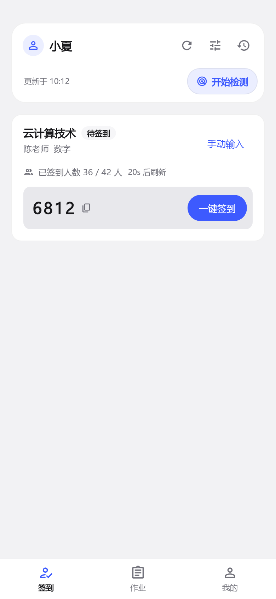
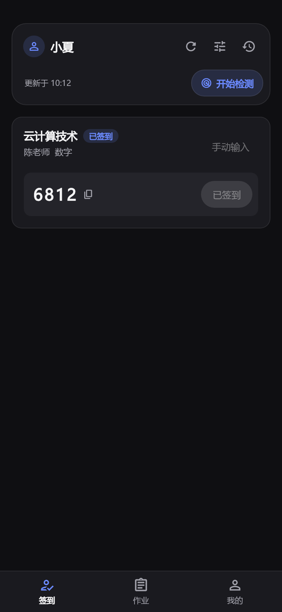
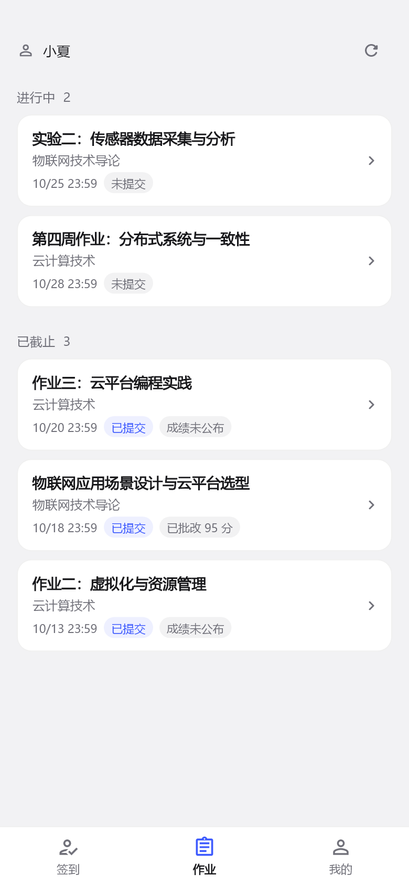
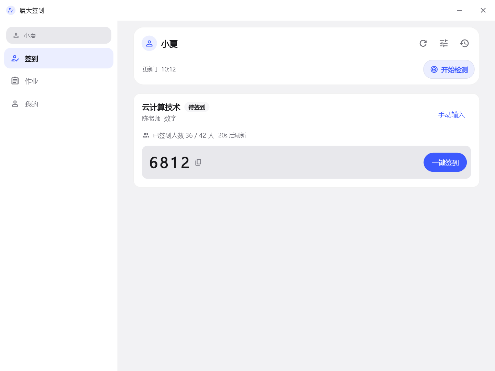
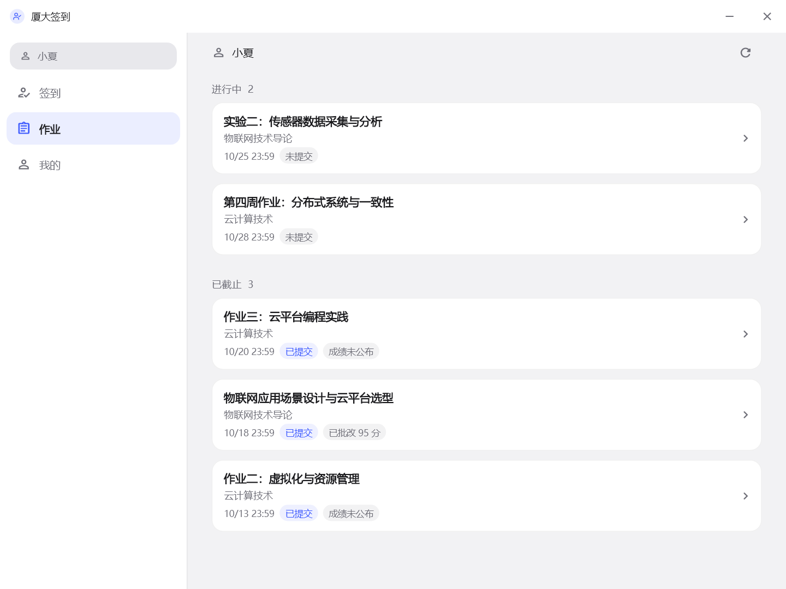
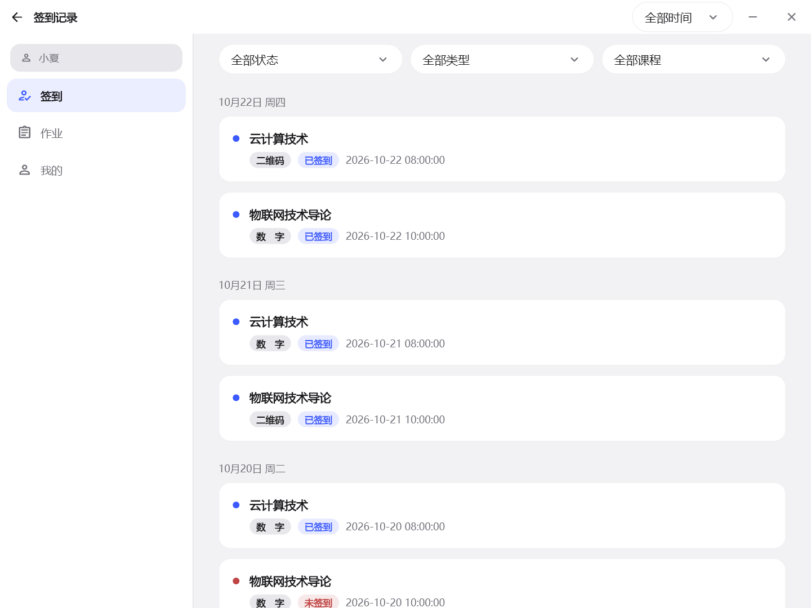

<div align="center">


# 厦大签到

**上课看签到，下课看作业。**

一个给厦门大学畅课（TronClass）用的小客户端。手机随手查看，电脑也能用。

[](https://flutter.dev/)
[](#界面预览)
[](https://github.com/MidiAug/xmu-rollcall/actions/workflows/checks.yml)
[](LICENSE)

[看看界面](#界面预览) / [有什么功能](#日常会用到的) / [下载安装](#下载安装) / [运行起来](#运行起来) / [反馈问题](https://github.com/MidiAug/xmu-rollcall/issues)

</div>

## 界面预览

用现有 Flutter 页面和演示数据渲染，展示手机与 Windows 布局；截图中的姓名、课程和作业状态均为虚构示例。

### Android

先看正在签到的这门课。数字码、已签到人数和刷新倒计时放在一起；完成签到后，数字码仍会保留。每张图只展示一门正在签到的课程。

<table>
  <tr>
    <th>待签到</th>
    <th>已签到（深色模式）</th>
    <th>课后看作业</th>
  </tr>
  <tr>
    <td align="center"></td>
    <td align="center"></td>
    <td align="center"></td>
  </tr>
</table>

### Windows

电脑上也能直接查看当前签到，使用侧栏切换页面。支持托盘驻留、系统通知和桌面二维码识别。



<details>
<summary>再看看作业与签到记录</summary>

| 作业一眼看清 | 签到记录慢慢查 |
| :---: | :---: |
|  |  |

</details>

点击图片可以查看大图。

## 日常会用到的

| 想做什么 | 这里可以 |
| --- | --- |
| **看看老师开没开签到** | 查看数字、雷达和二维码签到，复制数字码、确认位置或扫码提交。 |
| **翻翻之前的签到** | 按课程、状态、类型和最近 7 天 / 30 天筛选，筛选项旁边直接显示记录数。 |
| **今天还有什么作业** | 进行中和已截止分开展示，截止时间、提交情况、成绩状态放在同一行。助教课程单独展示。 |
| **看这学期的课** | 按当前身份展示本学期课表，不把入学以来的课程都搬出来。 |
| **切换协助身份** | 各身份的登录会话与缓存独立保存，签到和作业跟随所选身份。 |
| **少盯一会儿屏幕** | Android 后台提醒，Windows 通知与托盘；数字与有本课位置的雷达自动签到需要自行开启。 |

重新打开页面时，会优先显示已有缓存，再按需要更新。签到卡片在对应课堂的课前、课后各 25 分钟内恢复上次状态，并重新确认；作业按课后、截止和待办变化补查，避免来回切页就重扫所有课程。

检测负责发现签到，自动签到默认关闭。开启后，数字签到按已设置的人数或比例等待；雷达还需本账号、本课程已设置或上次成功的位置，没有位置时只提醒。可在雷达页先选点并“设为本课位置”，无需先提交一次签到；雷达自动提交失败或结果不确定时，请打开签到页手动处理。

提醒设置按“测试 → 实际收到确认 → 按表现排查”组织。前台显示应用内提醒，后台发送系统通知，自动签到结果会更新提醒。Android 需允许通知并按手机实际情况设置后台运行；Windows 需保留应用运行，睡眠或退出后不继续检测。

## 下载安装

应用启动及回到前台会按间隔静默检查 GitHub 正式更新；“我的 → 关于”右侧出现“有更新”时，可进入查看说明并下载，也可手动检查。同一次运行中，成功检查后 6 小时、失败后 30 分钟内不重复自动请求，不自动下载或弹窗催更。下载完成后校验大小与 SHA-256，再由你确认安装；Android 按系统提示允许安装来源，Windows 会在确认后停止检测、退出应用并打开安装向导。便携版使用安装器更新会转为安装版，也可从发布页手动下载便携 ZIP。

应用内安装要求 Release 带有工作流生成的 `manifest-android.json` / `manifest-windows.json` 和对应安装包；旧发布缺少清单时保留浏览器入口。Android 必须沿用兼容签名并递增构建号；preview 测试版与正式版独立安装。尚不支持更新检查的旧版，首次需从发布页手动升级。

[最新正式版及全部安装包](https://github.com/MidiAug/xmu-rollcall/releases/latest)

| 平台 | 下载 | 怎么用 |
| --- | --- | --- |
| Android | [最新发布页](https://github.com/MidiAug/xmu-rollcall/releases/latest) | 选择以 `-android.apk` 结尾的安装包，下载后在手机上安装。 |
| Windows x64 | [最新发布页](https://github.com/MidiAug/xmu-rollcall/releases/latest) | 选择以 `-windows-x64-setup.exe` 结尾的安装程序，按提示安装。 |
| Windows x64 | [最新发布页](https://github.com/MidiAug/xmu-rollcall/releases/latest) | 选择以 `-windows-x64.zip` 结尾的便携包；完整解压后运行 `xmu_rollcall.exe`，保留同目录的 DLL 和 `data` 文件夹。 |

Android 当前沿用项目开发签名；Windows 安装程序尚无发布者数字签名。覆盖更新需使用同一 Android 签名。

## 运行起来

目前主要在 **Android 和 Windows** 上开发与验证。仓库也保留了 iOS、macOS、Linux 工程，但这些平台还没有完成完整实机验收。

准备 **Flutter 3.44.0 / Dart 3.12**，以及目标平台所需的开发工具：

```powershell
git clone https://github.com/MidiAug/xmu-rollcall.git
cd xmu-rollcall
flutter pub get

# 连接手机后，选择设备运行
flutter run

# 或者在 Windows 上运行
flutter run -d windows
```

使用厦大统一身份认证账号登录；遇到验证码时按页面提示处理。相机扫码需要相机权限，后台提醒需要允许通知，并按系统提示设置后台运行。

<details>
<summary><strong>自己打包、更新和跑测试</strong></summary>

### 构建安装包

```powershell
# Android APK
flutter build apk --release

# Windows
flutter build windows --release
```

也可以用项目脚本，产物会放到 `dist/`：

```powershell
# Android APK
powershell -ExecutionPolicy Bypass -File scripts/package-android.ps1

# Windows NSIS 安装包与便携 ZIP
powershell -ExecutionPolicy Bypass -File scripts/package-windows.ps1
```

Windows 构建需要 Visual Studio 的 C++ 桌面开发工具；安装包还需要 NSIS，打包脚本可在缺少 NSIS 时下载便携工具。

### 给手机覆盖更新

```powershell
powershell -ExecutionPolicy Bypass -File scripts/install-phone.ps1 -Mode release
```

脚本使用 `adb install -r` 保留登录和设置。更新时请沿用相同签名和构建模式；如果手机装的是 debug 版，参数也用 `-Mode debug`。

### 本地检查

```powershell
flutter analyze
flutter test
```

普通测试使用模拟数据；真实账号、设备权限和后台行为需要单独做实机检查。GitHub Actions 在 Windows 和 Linux 上运行静态分析、单元/组件及模拟会话集成测试；主分支通过后自动生成 Android 测试 APK 和 Windows 安装包/便携 ZIP。版本标签经过正式签名与产物校验后生成 Release 草稿，更新说明自动取自 [CHANGELOG.md](CHANGELOG.md) 对应版本，确认设备验收后手动发布。详见 [CI/CD 与签名配置](.github/CI_CD.md)。

</details>

## 遇到问题了？

欢迎到 [Issues](https://github.com/MidiAug/xmu-rollcall/issues) 描述发生了什么，附上系统版本、操作步骤和截图会更容易定位。

应用里的“我的 → 数据与诊断”可以清理缓存、导出诊断日志。日志已做脱敏，分享前也请检查是否含有不想公开的个人信息；不要在 Issue 中提交账号密码、Cookie 或登录令牌。

账号凭据使用系统安全存储，课表、作业和签到缓存保存在本机。

## 感谢这些项目

开发时从这些项目中得到了不少帮助：

- [wilinz/tronclass_plus](https://github.com/wilinz/tronclass_plus)：Flutter 客户端架构、网络与位置交互的参考。
- [KrsMt-0113/XMU-Rollcall-Bot](https://github.com/KrsMt-0113/XMU-Rollcall-Bot)、[dangzitou/xmu-rollcall-bot](https://github.com/dangzitou/xmu-rollcall-bot)：厦大畅课接口参考。
- [KrsMt-0113/xmulogin](https://github.com/KrsMt-0113/xmulogin)：厦大统一身份认证参考。

## 许可与说明

本项目采用 [MIT License](LICENSE)。

这是非官方客户端，与厦门大学及畅课官方无隶属关系。请遵守学校规定，确认签到内容与位置真实有效。自动签到默认关闭，需要为当前账号主动配置。
